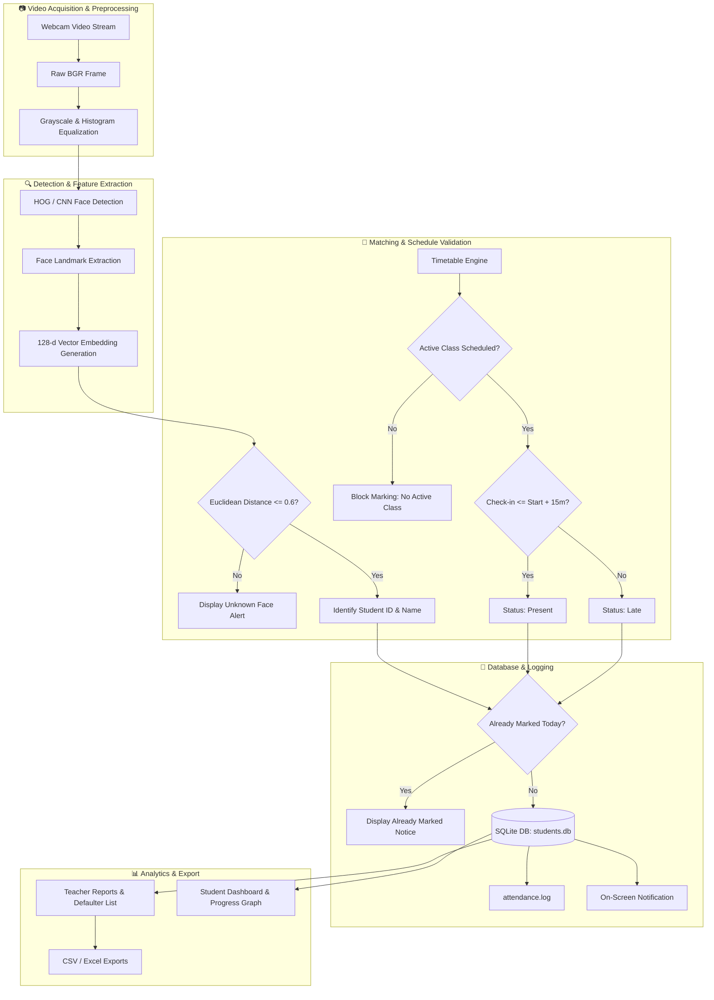

<div align="center">

# 🎓 Facial Recognition Attendance System (v2.0)

**An intelligent, automated, and tamper-proof attendance management platform powered by Computer Vision, deep metric learning, and timetable scheduling.**

[](https://www.python.org/)
[](https://opencv.org/)
[](https://github.com/ageitgey/face_recognition)
[](https://www.sqlite.org/)
[](https://docs.python.org/3/library/tkinter.html)
[](LICENSE)

<br/>

[Key Features](#-key-features) •
[Architecture](#-system-architecture) •
[Installation](#-installation--prerequisites) •
[Quick Start](#-quick-start-guide) •
[Portals & Usage](#-portals--workflows) •
[Database Schema](#-database-schema) •
[Project Structure](#-project-structure) •
[Configuration](#-configuration--thresholds)

</div>

---

## 📖 Overview

The **Facial Recognition Attendance System** replaces outdated paper sign-in sheets, magnetic swipe cards, and biometric fingerprint scanners with an automated, contactless, real-time facial recognition solution.

Equipped with a **128-dimensional deep metric learning engine**, real-time **timetable synchronization**, **anti-proxy validation**, and **intelligent image stability checks**, this platform guarantees accurate, auditable, and automated attendance logging for educational institutions and corporate classrooms.

### ✨ What's New in v2.0
* **Smart Mode Selection**: Distinct toggle between **"New Student"** registration and **"Re-register Existing"** face updates to eliminate accidental duplicates.
* **Intelligent Capture Verification**: Real-time evaluation of Laplacian sharpness variance ($\ge 80$), frame brightness ($\ge 45$), and 5-frame stability tracking before encoding capture.
* **Anti-Collision Duplicate Shield**: Automatically scans the existing facial vector space ($L_2$ distance $\le 0.5$) to prevent one person from registering under multiple IDs.
* **Timetable Conflict Resolution Engine**: Mathematical overlap algorithm ensures class schedules cannot collide, and marks attendance strictly within class operating hours.
* **Unified Modern UI**: Overhauled design system (`theme.py`) featuring a cohesive Navy (`#0f172a`) & Bright Blue (`#1f4f8f`, `#3b82f6`) palette, responsive card layouts, and hover animations.

---

## 🚀 Key Features

### 👤 1. Real-Time Facial Recognition
- **Deep Metric Learning**: Generates 128-dimensional facial embeddings using the `dlib` state-of-the-art ResNet model.
- **Euclidean Distance Matching**: Compares detected face vectors against registered vectors with a calibrated match threshold of `0.6` and computes a normalized confidence percentage.
- **Histogram Equalization Preprocessing**: Equalizes luminance variations to maintain high recognition accuracy in poor lighting conditions.
- **Multi-Face Processing**: Concurrently detects and recognizes multiple faces in the camera frame.

### 📅 2. Timetable-Aware Scheduling & Anti-Proxy Guard
- **Active Class Window Detection**: Restricts automated marking strictly to classes actively in session.
- **Automated Present vs. Late Tagging**: Evaluates student check-in time against the class start time. Students within the 15-minute grace window are flagged as **Present**; check-ins after 15 minutes are marked **Late**.
- **Cooldown & Duplicate Prevention**: Enforces a strict one-record-per-student-per-subject-per-day rule with a 30-second rapid-retrigger cooldown lock.
- **Automated Absence Provisioning**: Backend capability to batch-flag non-attending students as **Absent** when class concludes.

### 📸 3. High-Fidelity Student Face Registration
- **Quality Assurance**: Inspects frame brightness and Laplacian sharpness variance to reject blurry or dark captures.
- **Multi-Frame Stability**: Requires 5 consecutive stable frames with a single centered face before enabling capture.
- **Duplicate Face Detection**: Prevents buddy punching by cross-referencing new captures with all existing biometric records.
- **Auto-Generated Secure Passwords**: Automatically sets student portal passwords in the format `STU<last-4-digits-of-id>`.

### 📊 4. Dedicated Portals & Reporting
- **Central Launchpad (`app.py`)**: Real-time overview cards displaying total students, registered faces, faculty members, scheduled classes, and today's attendance count.
- **Teacher Workspace**:
  - Live status indicator of current class.
  - One-click launch for facial attendance camera engine.
  - Manual attendance override form (Present / Late / Absent).
  - Schedule creator with collision detection.
  - Advanced attendance reports with date, subject, and student ID filters.
  - **Low Attendance Warning System**: Instantly highlights students falling below custom thresholds (e.g., $< 75\%$).
  - One-click export to **CSV** and styled **Excel (.xlsx)** spreadsheets.
  - Face de-registration utility to safely wipe facial encodings without destroying student academic records.
- **Student Portal**:
  - Secure login using Student ID and auto-generated password.
  - Individual attendance dashboard with real-time percentage tracking.
  - Visual color-coded attendance chart rendered dynamically on canvas.
  - Issue grievance filing module with supporting proof (PDF/image) upload.

---

## 🏗 System Architecture

The following diagram illustrates the end-to-end data processing pipeline from video feed acquisition to database persistence and reporting:



---

## 💻 Tech Stack

| Domain | Technology / Library | Purpose |
| :--- | :--- | :--- |
| **Language** | Python 3.9+ | Core programming language |
| **Computer Vision** | OpenCV (`opencv-python`) | Video stream capture, frame manipulation, text rendering |
| **Deep Learning** | `face_recognition` (dlib) | HOG face detection & 128-dimensional deep metric embeddings |
| **Numerical Math** | NumPy & SciPy | Euclidean distance calculation & image quality variance checks |
| **Database** | SQLite3 | Embedded transactional ACID database with foreign keys |
| **GUI Framework** | Tkinter & `ttk` (clam theme) | Native cross-platform desktop user interface |
| **Reporting / Export** | `openpyxl` & CSV module | Structured workbook generation & audit logs |
| **Styling** | Custom Design System (`theme.py`) | Cohesive palette, fonts, cards, and stateful widgets |

---

## 📂 Project Structure

```plaintext
attendance_system/
│
├── app.py                      # 🌟 Central launchpad & primary application dashboard
├── main.py                     # 🎥 Real-time facial recognition attendance video loop
├── attendance_service.py       # ⚙️ Business logic (anti-proxy, cooldown, marking rules)
├── face_engine.py              # 🧠 Face encoding extraction, distance & confidence math
├── face_registration.py        # 📝 Student registration wizard with quality & stability checks
├── timetable.py                # 🕒 Schedule management engine with collision verification
├── current_class.py            # ⏰ Live popup monitor for the active scheduled class
├── database.py                 # 🗄️ SQLite schema management, auto-migrations & queries
├── theme.py                    # 🎨 Centralized design system (colors, typography, buttons)
│
├── student_login.py            # 🔑 Student portal authentication interface
├── student_dashboard.py        # 📈 Student personal attendance stats, chart & exports
├── student_portal.py           # 📌 Student grievance and issue reporting interface
│
├── teacher_login.py            # 🔐 Teacher authentication module
├── teacher_dashboard.py        # 👨‍🏫 Teacher administrative command center
├── teacher_manual.py           # ✍️ Manual attendance override window
├── teacher_reports.py          # 📑 Comprehensive attendance filtering & report exporter
├── manage_timetable.py         # 🗓️ Interactive class timetable management interface
├── remove_face_ui.py           # 🗑️ Safe face profile unlinking utility
│
├── test_timetable_conflicts.py # 🧪 Unit tests for timetable overlap & validation rules
├── teachers.csv                # 👥 Seed/fallback credentials for teaching staff
├── requirements.txt            # 📦 Python project dependencies
├── students.db                 # 🗃️ SQLite database (auto-generated on initial run)
├── attendance.log              # 📜 System-wide operational and recognition logs
└── exports/                    # 📁 Generated CSV and Excel attendance exports
```

---

## 🔧 Installation & Prerequisites

### Prerequisites
* **Operating System**: Windows 10/11, macOS, or Linux.
* **Python**: Python 3.8 to 3.10 recommended (compatible with pre-built `dlib` wheels).
* **Webcam**: Integrated or external USB camera.
* **C++ Compiler (Windows only, if building dlib from source)**: Visual Studio C++ Build Tools or pre-built binary wheel for `dlib`.

---

### Step 1: Clone the Repository
```bash
git clone https://github.com/Blhemanth/Facial-Recognition-Attendance-System.git
cd Facial-Recognition-Attendance-System
```

### Step 2: Create and Activate a Virtual Environment
```bash
# Windows (PowerShell)
python -m venv myenv
.\myenv\Scripts\Activate.ps1

# Linux / macOS
python3 -m venv myenv
source myenv/bin/activate
```

### Step 3: Install Dependencies
```bash
pip install --upgrade pip
pip install -r requirements.txt
```

> **Note for Windows Users installing `dlib`:**
> If `pip install dlib` fails due to CMake or C++ compiler requirements, install a pre-compiled `.whl` suitable for your Python version, or install CMake:
> ```bash
> pip install cmake
> ```

---

## 🚦 Quick Start Guide

### 1. Initialize the Database
The database automatically self-heals and provisions tables upon startup. You can also explicitly verify it:
```bash
python setup_db.py
```

### 2. Launch the Master Application Dashboard
Run the central dashboard to access all system modules:
```bash
python app.py
```

### 3. Launch the Facial Attendance Camera Engine Directly
To deploy the recognition stream independently (e.g., on a dedicated classroom terminal):
```bash
python main.py
```
* **Exit**: Press <kbd>ESC</kbd> or <kbd>Q</kbd> to safely release the camera and close the window.

---

## 👥 Portals & Workflows

### 1. Face Registration Workflow
1. Open **Face Registration** from the main dashboard.
2. Select your mode:
   - **🆕 New Student**: For initial registration.
   - **🔄 Re-register Existing**: To refresh or overwrite an existing student's face data.
3. Fill in **Student ID**, **Full Name**, and **Department** (e.g., `CSE`).
4. Click **Capture Face and Register**.
5. When the camera opens:
   - Align your face inside the bounding box in a well-lit area.
   - The status bar verifies brightness and sharpness.
   - Once stabilized for 5 frames, the box turns **Green** with status `READY - Press SPACE`.
   - Press <kbd>SPACEBAR</kbd> to capture.
6. The system checks for duplicate faces across the database. If unique, the student is saved, and their initial password (e.g., `STU0001`) is displayed.

---

### 2. Timetable Management Workflow
1. Open **Manage Timetable** from the dashboard or teacher portal.
2. Enter the subject title, choose the schedule frequency (**Daily** or a specific day like **Monday**), set the start and end times in `HH:MM` format (24-hour), and assign a teacher.
3. Click **Add / Update Class**.
   - The built-in mathematical overlap validator ensures no overlapping class times can be scheduled on the same day.
   - Back-to-back classes (e.g., `09:00 - 10:00` and `10:00 - 11:00`) are explicitly supported.

---

### 3. Teacher Workspace
* **Login**: Accessible via `teacher_login.py` or the main dashboard.
* **Credentials**: Synced from `teachers.csv` or database.

| Username | Default Password | Faculty Name | Teacher ID |
| :--- | :--- | :--- | :--- |
| `prakash` | `1234` | K Prakash | T001 |
| `aswathy` | `1234` | Aswathy N Rajan | T002 |
| `rani` | `1234` | Rani Kumari | T003 |
| `bhavana` | `1234` | Bhavana S | T007 |

* **Actions Available**:
  - **Start Facial Attendance**: Opens real-time camera recognition.
  - **Manual Attendance**: Mark a student absent, late, or present without video input.
  - **Attendance Reports**: Filter by date, class, or student ID. View total attendance percentages and download audit spreadsheets.
  - **Low Attendance Filter**: Type in a minimum required threshold (e.g., `75%`) to list all defaulting students.

---

### 4. Student Portal
* **Login**: Accessible via `student_login.py` or the main dashboard.
* **Credentials**:
  - **Student ID**: Registered student ID (e.g., `01`, `04`).
  - **Password**: Default is `STU` + last 4 digits of student ID (e.g., ID `01` $\rightarrow$ `STU0001`).
* **Features**:
  - Real-time overall attendance percentage badge.
  - Interactive history table with color-coded tags (**Green** for Present, **Amber** for Late, **Red** for Absent).
  - Canvas-rendered graphical distribution chart.
  - One-click export of personal records to CSV/Excel.
  - Grievance submission with file attachment proof.

---

## 🗄 Database Schema

The SQLite database (`students.db`) enforces relational integrity with foreign keys enabled:

```
┌─────────────────────────┐         ┌─────────────────────────┐
│        students         │         │        teachers         │
├─────────────────────────┤         ├─────────────────────────┤
│ student_id (PK, TEXT)   │         │ teacher_id (PK, TEXT)   │
│ name (TEXT)             │         │ name (TEXT)             │
│ parent_phone (TEXT)     │         │ username (TEXT, UNIQUE) │
│ face_encoding (BLOB)    │         │ password (TEXT)         │
│ department (TEXT)       │         └────────────┬────────────┘
│ password (TEXT)         │                      │ 1
└───────────┬─────────────┘                      │
            │ 1                                  │ has many
            │                                    │
            │ has many                           ▼ 0..*
            │                       ┌─────────────────────────┐
            │                       │        timetable        │
            │                       ├─────────────────────────┤
            │                       │ class_id (PK, AUTO)     │
            │                       │ subject (TEXT)          │
            │                       │ start_time (TEXT, HH:MM)│
            │                       │ end_time (TEXT, HH:MM)  │
            │                       │ teacher_id (FK, TEXT)   │
            │                       │ day (TEXT)              │
            │                       │ created_at, updated_at  │
            │                       └────────────┬────────────┘
            │                                    │ 1
            ▼ 0..*                               │ has many
┌────────────────────────────────────────┐       │
│               attendance               │       ▼ 0..*
├────────────────────────────────────────┴───────────────────┐
│ id (PK, INTEGER AUTOINCREMENT)                             │
│ student_id (FK -> students.student_id, ON DELETE CASCADE)  │
│ name (TEXT)                                                │
│ date (TEXT, YYYY-MM-DD)                                    │
│ time_in (TEXT, HH:MM:SS)                                   │
│ subject (TEXT)                                             │
│ status (TEXT: 'Present' | 'Late' | 'Absent')               │
│ confidence (REAL)                                          │
│ class_id (FK -> timetable.class_id, ON DELETE SET NULL)    │
│ created_at (TEXT)                                          │
└────────────────────────────────────────────────────────────┘
```

---

## ⚙️ Configuration & Thresholds

System settings can be fine-tuned directly in the modular python files:

| File | Constant / Parameter | Default | Description |
| :--- | :--- | :--- | :--- |
| `face_engine.py` | `FACE_MATCH_THRESHOLD` | `0.6` | Maximum Euclidean distance for a positive face match. Lower is stricter. |
| `face_registration.py` | `BLUR_THRESHOLD` | `80.0` | Minimum variance of Laplacian for sharpness validation. |
| `face_registration.py` | `BRIGHTNESS_THRESHOLD` | `45.0` | Minimum mean grayscale pixel brightness. |
| `face_registration.py` | `DUPLICATE_FACE_THRESHOLD` | `0.5` | Threshold to detect if a face is already registered under another ID. |
| `face_registration.py` | `STABLE_FACE_FRAMES` | `5` | Number of consecutive valid frames required before enabling capture. |
| `timetable.py` | `ATTENDANCE_WINDOW_MIN` | `15` | Grace duration in minutes from class start before status changes to **Late**. |
| `attendance_service.py` | `ATTENDANCE_COOLDOWN_SECONDS` | `30` | Minimum elapsed seconds between recognition triggers for the same student. |

---

## 🧪 Testing

The timetable scheduling and conflict detection module includes an automated `unittest` test suite covering overlap formulas, edge cases, and back-to-back classes:

```bash
python test_timetable_conflicts.py
```

**Expected output:**
```plaintext
test_back_to_back_class_is_allowed (__main__.TimetableConflictTests) ... ok
test_daily_class_conflicts_with_specific_day (__main__.TimetableConflictTests) ... ok
test_different_day_overlap_is_allowed (__main__.TimetableConflictTests) ... ok
test_overlap_formula_blocks_only_real_overlap (__main__.TimetableConflictTests) ... ok
test_same_day_overlap_is_rejected (__main__.TimetableConflictTests) ... ok
test_update_excludes_the_same_class_but_blocks_other_conflicts (__main__.TimetableConflictTests) ... ok

----------------------------------------------------------------------
Ran 6 tests in 0.281s

OK
```

---

## ❓ Frequently Asked Questions (FAQ)

<details>
<summary><b>1. Why does the camera window say "No active class is scheduled right now"?</b></summary>
Automatic attendance marking is bound to the timetable. Open <b>Manage Timetable</b>, check today's classes, and ensure there is an active class whose start and end times encompass the current clock time.
</details>

<details>
<summary><b>2. How does the system handle students wearing glasses or in dim light?</b></summary>
The camera engine applies <b>Histogram Equalization</b> to normalise lighting across the grayscale spectrum. While standard optical glasses are supported, heavy glare or dark sunglasses may lower recognition confidence.
</details>

<details>
<summary><b>3. What happens if someone tries to register another student's face?</b></summary>
During registration, <code>find_duplicate_face()</code> compares the candidate 128-d vector against all existing database vectors. If a distance $\le 0.5$ is detected, the registration is rejected with an alert naming the original owner.
</details>

<details>
<summary><b>4. Where are exported files saved?</b></summary>
All CSV and Excel attendance reports are saved automatically in the <code>exports/</code> directory located at the project root.
</details>

---

## 🗺 Roadmap

- [ ] **Blink & Motion Liveness Detection**: Integrate EAR (Eye Aspect Ratio) landmark tracking from `liveness.py` to prevent static photo / screen spoofing.
- [ ] **Automated Absentee Alerts**: Connect `notifier.py` with an SMS gateway (Twilio) or SMTP email server to inform parents of absentees automatically.
- [ ] **FastAPI / Flask Web Dashboard**: Transition the desktop UI to a lightweight responsive web interface for mobile access.
- [ ] **RTSP IP Camera Stream Support**: Support multi-room RTSP CCTV streams directly from a central server.

---

## 📄 License

This project is open-source and distributed under the **MIT License**. See the `LICENSE` file for full terms and conditions.

---

<div align="center">
  <sub>Developed with ❤️ for streamlined, accurate, and contactless attendance tracking.</sub>
</div>